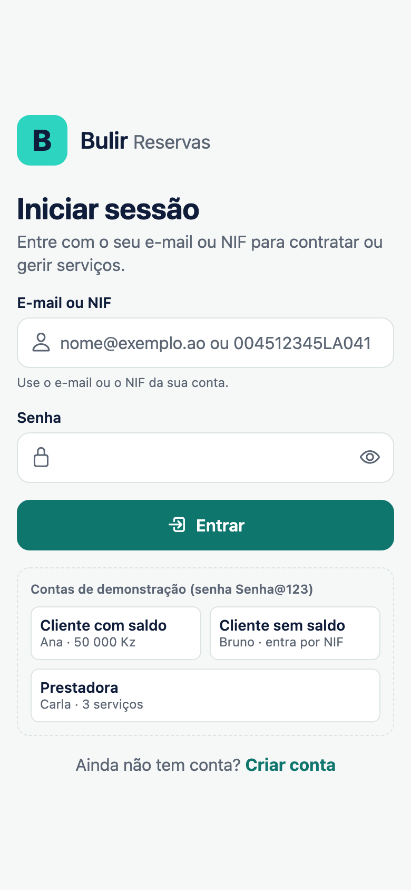
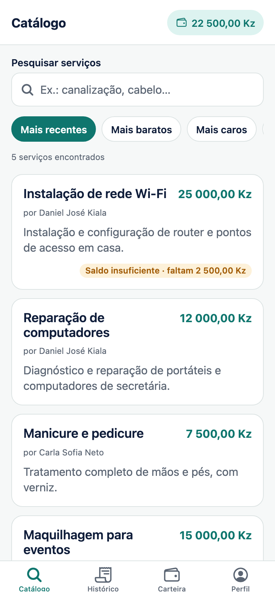
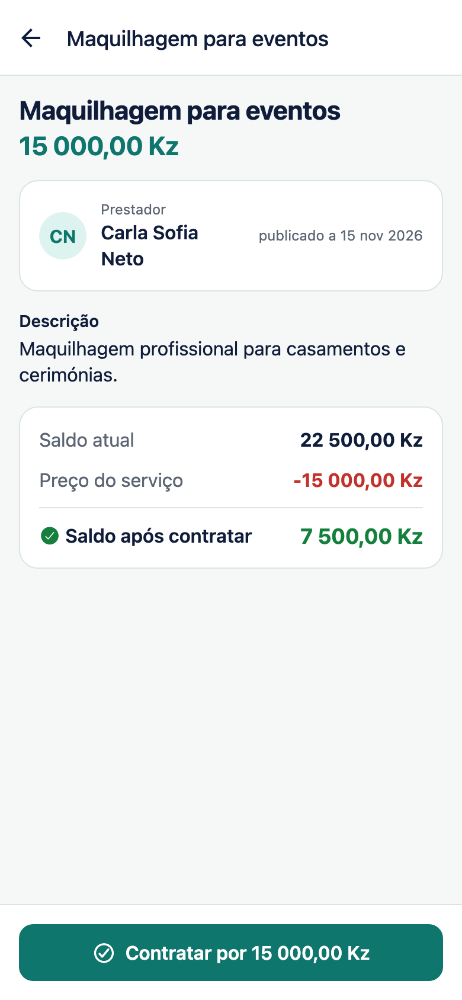
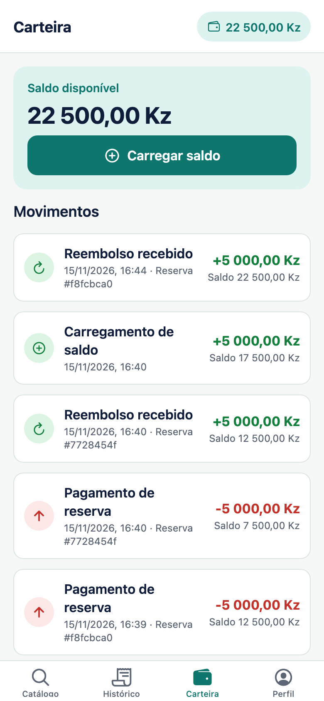
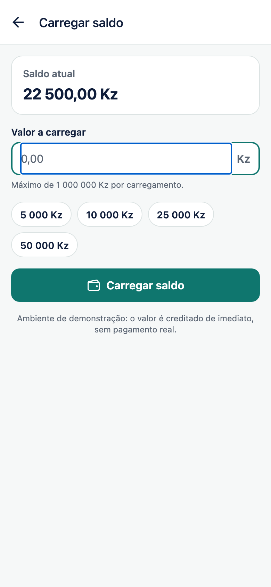
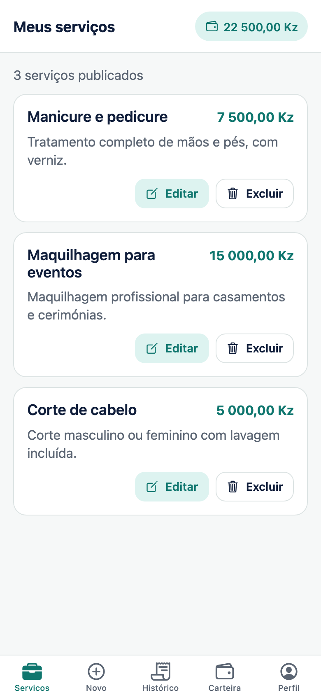
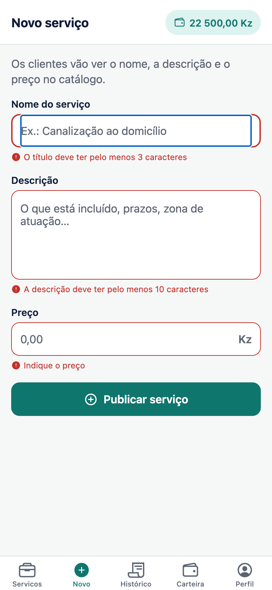

# Bulir Reservas — App mobile (Desafio 3)

App **React Native + Expo + TypeScript** da plataforma de reservas de serviços da Bulir. Consome a API do
Desafio 1 (NestJS) e reproduz no telemóvel a app web do Desafio 2: clientes contratam serviços de prestadores
com saldo em Kwanzas; prestadores publicam e gerem os seus serviços.

- **API:** [`bulir-reservas-api`](https://github.com/InacioRodrigues/bulir-reservas-api) · **Web:** [`bulir-reservas-web`](https://github.com/InacioRodrigues/bulir-reservas-web)
- Corre no **Expo Go** (sem Xcode/Android Studio) ou como **APK** (EAS Build).

| Login                                   | Catálogo                                      | Contratar                                               | Histórico                                       |
| --------------------------------------- | --------------------------------------------- | ------------------------------------------------------- | ----------------------------------------------- |
|  |  |  |  |

| Carteira                                      | Carregar saldo                                            | Prestador                                                    | Validação                                                       |
| --------------------------------------------- | --------------------------------------------------------- | ------------------------------------------------------------ | --------------------------------------------------------------- |
|  |  |  |  |

> Capturas feitas com `expo start --web` num viewport de telemóvel (390×844) contra a API local.

## Funcionalidades

**Autenticação**

- Login com **e-mail ou NIF** no mesmo campo (a ajuda indica qual está a ser usado) + senha; atalhos para as contas de demonstração.
- Registo com escolha do papel (Cliente/Prestador), validação igual à da API e erros de e-mail/NIF duplicado no campo certo.
- Sessão restaurada no arranque (splash mantido até se saber se há sessão), refresh token rotativo transparente, logout com confirmação que revoga o refresh token.
- `429` respeita o `Retry-After`: o botão "Entrar" fica bloqueado com contagem decrescente.

**Prestador** — separadores _Serviços_ e _Novo_

- Lista infinita dos seus serviços (pull-to-refresh), criar, **editar** (PATCH só com os campos alterados) e **excluir** com `Alert` de confirmação.

**Cliente** — separador _Catálogo_ (só clientes o veem)

- Pesquisa com debounce, ordenação (recentes, preço, nome) e scroll infinito.
- Cada cartão avisa "Saldo insuficiente · faltam X Kz" **antes** de abrir o serviço.
- Detalhe com resumo **saldo atual → preço → saldo após**; o botão "Contratar" fica bloqueado sem saldo; confirmação nativa com os mesmos valores.
- Carregar saldo (modal) com valores rápidos e o **valor em falta sugerido**.
- Depois de contratar/cancelar/carregar, saldo, reservas e movimentos são recarregados do servidor (sem cálculos otimistas sobre dinheiro).

**Histórico e carteira** (ambos os papéis)

- Reservas com **serviço, prestador, cliente, valor, data e estado**; filtro por estado; cancelamento pelo cliente ou pelo prestador com mensagem de reembolso.
- Carteira com saldo e extrato (créditos/débitos com sinal e saldo após cada movimento).
- Saldo sempre visível no header (toca para abrir a carteira) e atualizado a cada 30 s e ao voltar à app.

**UX/acessibilidade:** modo claro/escuro, safe areas, teclado não tapa campos (`KeyboardAvoidingView` + `resize` no Android),
estados de carregamento/vazio/erro com "tentar novamente", toasts anunciados ao leitor de ecrã, `accessibilityLabel`/`Role`/`State`
em todos os controlos, alvos de toque ≥ 44–48 pt, tamanho de letra do sistema respeitado, haptics discretos,
**2 colunas em tablets/landscape**, error boundary e ecrã 404.

## Stack e decisões

| Escolha                                             | Porquê                                                                                                                                                                                                                                            | Alternativas                                                            |
| --------------------------------------------------- | ------------------------------------------------------------------------------------------------------------------------------------------------------------------------------------------------------------------------------------------------- | ----------------------------------------------------------------------- |
| **Expo SDK 58 + Expo Router**                       | Forma recomendada pela equipa do React Native; corre no Expo Go por QR code (avaliação sem toolchain nativa); EAS gera o APK na cloud. Rotas por ficheiros com grupos `(auth)`/`(app)`                                                            | React Native CLI (exige Xcode/Android Studio); React Navigation "à mão" |
| **Guards com `Stack.Protected` / `Tabs.Protected`** | Os ecrãs de um papel deixam de existir no navegador do outro; ao terminar a sessão o utilizador é levado ao login sem `useEffect` de redirecionamento                                                                                             | `<Redirect>` em cada ecrã                                               |
| **TanStack Query** (infinite queries)               | Estado do servidor com cache, `fetchNextPage` no `onEndReached`, pull-to-refresh, invalidação por chave; `focusManager` ligado ao `AppState`                                                                                                      | Redux Toolkit Query, SWR                                                |
| **Zustand**                                         | Estado do cliente mínimo (sessão e toasts), utilizável fora de componentes (interceptors do axios)                                                                                                                                                | Context API, Redux                                                      |
| **expo-secure-store** para os tokens                | Keychain (iOS) / Keystore (Android): cifrado pelo sistema, isolado da app, `WHEN_UNLOCKED_THIS_DEVICE_ONLY` (não vai para backups). O AsyncStorage é texto simples                                                                                | AsyncStorage, MMKV                                                      |
| **Axios** com interceptors                          | Injeta o Bearer; num `401` faz **um único refresh partilhado** por todos os pedidos simultâneos (a API revoga todas as sessões se um refresh token for reutilizado) e repete-os                                                                   | `fetch` + wrapper                                                       |
| **React Hook Form + Zod**                           | Os **mesmos schemas da web** (copiados), com normalização de NIF/e-mail/dinheiro ("15 000,50" → `"15000.50"`); erros `400` da API mapeados para os campos                                                                                         | Formik + Yup                                                            |
| **Componentes próprios com tokens de tema**         | Poucas dependências, controlo total da acessibilidade, identidade igual à web                                                                                                                                                                     | NativeWind, Tamagui, React Native Paper                                 |
| **Dinheiro em BigInt e formatação manual**          | Valores trafegam como string; somas/comparações em cêntimos (sem vírgula flutuante). `formatKz`/datas não usam `Intl` porque no Hermes o suporte de `pt-AO`/`timeZone` varia entre Android e iOS — o resultado é igual em todo o lado (e testado) | `Intl.NumberFormat`                                                     |

A **autorização real está na API** (403/409); os guards e o bloqueio do botão "Contratar" são UX. O saldo nunca é calculado
pela app: a pré-visualização "saldo após" é informativa e a API debita de forma atómica.

### Estrutura

```
src/
  app/                    rotas (Expo Router): _layout (providers + guards), index (redireciona por papel),
                          (auth)/login|register, (app)/ separadores, service/[id], edit-service/[id], top-up (modal)
  app-shell/              Providers (Query, safe area, tema da navegação), ErrorBoundary
  features/
    auth/                 api, hooks (useMe, useLogin…), LoginForm, RegisterForm, RoleSelector, ProfileScreen
    services/             api, hooks (infinite), ServiceCard, ServiceForm, Catalog/MyServices/Detail/Edit/New
    bookings/             api, hooks, BookingCard, HireSummary, HireButton, BookingsScreen
    wallet/               api, hooks, BalanceChip, TransactionRow, WalletScreen, TopUpScreen
  shared/
    api/                  http (axios + refresh), errors (ApiError + mensagens pt), query-client, query-keys, infinite
    contract/             tipos e schemas zod do contrato (iguais à web)
    lib/                  money, date, confirm, haptics, strings
    session/              session-store (Zustand) + secure-storage
    theme/ ui/ hooks/     tokens, componentes base (Button, TextField, Card, InfiniteList, toast…)
  test/                   fake-api (adapter axios), fixtures, render, guards.test
```

## Como correr

Pré-requisitos: Node 20+ e a API do Desafio 1 a correr (ver README da API: `npm run docker:dev && npm run start:prod`, seed incluído).

```bash
cp .env.example .env    # definir EXPO_PUBLIC_API_URL (ver tabela abaixo)
npm install
npm start               # mostra o QR code
```

| Onde corre a app                             | `EXPO_PUBLIC_API_URL`                                                                                 |
| -------------------------------------------- | ----------------------------------------------------------------------------------------------------- |
| Telemóvel com **Expo Go** (mesma rede Wi-Fi) | `http://<IP-do-computador>:3000` (ex.: `http://192.168.1.20:3000`; no macOS `ipconfig getifaddr en0`) |
| Emulador Android                             | `http://10.0.2.2:3000`                                                                                |
| Simulador iOS / `npm run web`                | `http://localhost:3000`                                                                               |
| API em produção                              | `https://bulir-reservas-api-15sk.onrender.com`                                                        |

> Num telemóvel físico `localhost` é o próprio telemóvel, por isso é preciso o IP da máquina (e a firewall tem de permitir a porta 3000).
> O Expo web (`npm run web`, porta 8081) já está nas origens CORS por omissão da API.

**Expo Go:** instale a app _Expo Go_ (Play Store / App Store), corra `npm start` e leia o QR code (Android: na app Expo Go; iOS: câmara).
Se a rede bloquear a ligação, use `npx expo start --tunnel`.

### Contas de demonstração (seed da API)

Senha comum: `Senha@123` (também há atalhos no ecrã de login).

| Papel             | E-mail                        | NIF              |
| ----------------- | ----------------------------- | ---------------- |
| Cliente com saldo | `ana.cliente@bulir.demo`      | `004512345LA041` |
| Cliente sem saldo | `bruno.cliente@bulir.demo`    | `006798765LA042` |
| Prestadora        | `carla.prestadora@bulir.demo` | `5417001234`     |
| Prestador         | `daniel.prestador@bulir.demo` | `5417005678`     |

### APK (EAS Build)

`eas.json` tem o perfil `preview` que gera um **APK** instalável:

```bash
npm install -g eas-cli
eas login                       # conta Expo (gratuita)
eas init                        # associa o projeto à conta (escreve o projectId no app.json)
# editar EXPO_PUBLIC_API_URL no perfil "preview" do eas.json com a URL pública da API
eas build -p android --profile preview
```

O build corre na cloud da Expo; no fim é dado um link/QR para descarregar o APK.

## Qualidade

```bash
npm run typecheck   # tsc --noEmit (strict + noUncheckedIndexedAccess)
npm run lint        # ESLint (eslint-config-expo + react-hooks/compiler)
npm run format:check
npm test            # Jest (jest-expo) + Testing Library
npm run check       # tudo acima
```

**47 testes** em 9 suites:

- `money`, `date`, schemas zod, `ApiError`/mensagens;
- cliente HTTP: Bearer, **um só refresh para 3 pedidos 401 simultâneos**, tokens renovados gravados no SecureStore, sessão terminada se o refresh é rejeitado, sem refresh no 401 do login, `429` com `Retry-After`;
- `LoginForm` (validação, login por NIF normalizado, credenciais erradas, cooldown do 429), `ServiceForm` (mensagens do contrato, preço normalizado, PATCH parcial, erro 400 no campo), `HireButton` (bloqueado sem saldo, confirmação com saldo atual/após antes do POST, 409);
- **guards por papel com os layouts reais do Expo Router** (`renderRouter('./src/app')`): anónimo → login, cliente → catálogo sem separadores do prestador, prestador → "Meus serviços" sem catálogo, prestador não abre o detalhe de contratação.

A API nos testes é simulada no **adapter do axios** (`src/test/fake-api.ts`): os pedidos passam pelos interceptors reais sem rede.
O GitHub Actions corre typecheck, lint, formatação e testes em cada push.

**E2E (Maestro, opcional):** `.maestro/login-and-book.yaml` (login → contratar → cancelar) para correr num emulador/dispositivo com o APK:
`maestro test .maestro/`.

## Limitações conhecidas

- Na web (só usada para validação), abrir à mão o URL de um separador de outro papel leva a outro separador permitido e não ao inicial; numa app nativa não há barra de endereço.
- O ícone/splash são gerados por `scripts/generate-icons.mjs` a partir do logótipo (sem ferramentas de design).
